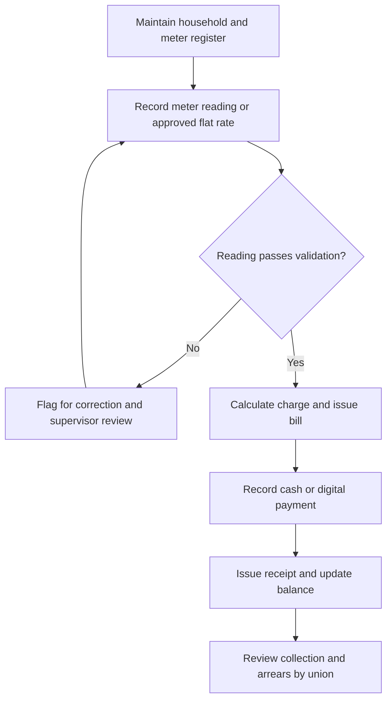

# DPHE Water Billing System

A case study based on a public-service billing system serving 23 unions. The workflow below describes a reference design for billing operations. Screens, names, readings, and figures are illustrative and do not contain resident records.

## Billing workflow

## Operating controls

| Control | Purpose |
| --- | --- |
| Unique connection and meter identifiers | Keep billing history attached to the right service connection. |
| Reading exception queue | Surface missing, reversed, or unusually high readings before bill generation. |
| Receipt sequence and payment audit trail | Reconcile collections with cashier or payment-channel records. |
| Period close by union | Give supervisors a consistent view of bills raised, collections, adjustments, and closing arrears. |

## Sample bill

| Field | Illustrative value |
| --- | --- |
| Union | Sample Union 04 |
| Connection | DEMO-00482 |
| Period | October 2026 |
| Previous and current reading | 1,280 and 1,294 units |
| Consumption | 14 units |
| Charge | ৳420 |
| Payment recorded | ৳300 |
| Balance due | ৳120 |

## Example management view

A union summary can show opening arrears, bills issued, adjustments, collections, and closing arrears. Managers can use it to identify unusual movements and assign follow-up. A balance is an operational signal and should be checked against due dates and approved adjustments before escalation.

The design keeps meter history, bill calculations, payment receipts, and adjustments traceable. Tariffs and sample values here are fictional. They should be replaced with the approved local schedule when implementing a real service.
